# Calculation Dependency Map

## Overview
This document maps the dependencies between all calculations in both workbooks.

## 1. Moisture Content (Kadar Air) Dependencies

### Input → Output Chain
```
E11 (Bobot wadah kosong) ──────────────────────────────────┐
                                                            │
E13 (Bobot sampel sebelum dikeringkan) ────┐                │
                                           │                │
E14 (Bobot wadah+sampel setelah dikeringkan) ──┐            │
                                               │            │
                                               v            v
H13 = E11 ─────────────────────────────────> H16 = H13+J13
J13 = E13 ──────────────────────────────────┘  │
L13 = E14 ──────────────────────────────────> J16 = L13
                                               │
                                               v
                                         H19 = H16-J16
H17 = E13 ──────────────────────────────> H20 = H17
                                               │
                                               v
                                         H22 = H19/H20
                                               │
                                               v
                                         H24 = H22*100  ──> E16 (output)
```

### Alternative Path
```
E12 = H16 ──────┐
                 v
E14 ──────> H33 = E12-E14
                 │
E13 ──────> H34 = E13
                 │
                 v
           H36 = H33/H34
                 │
                 v
           H38 = H36*100
```

### Topological Sort Order
1. Read E11, E13, E14
2. Calculate H13, J13, L13, H17
3. Calculate H16, J16
4. Calculate H19, H20
5. Calculate H22
6. Calculate H24 (Output E16)
7. Alternative: E12 -> H33, H34 -> H36 -> H38

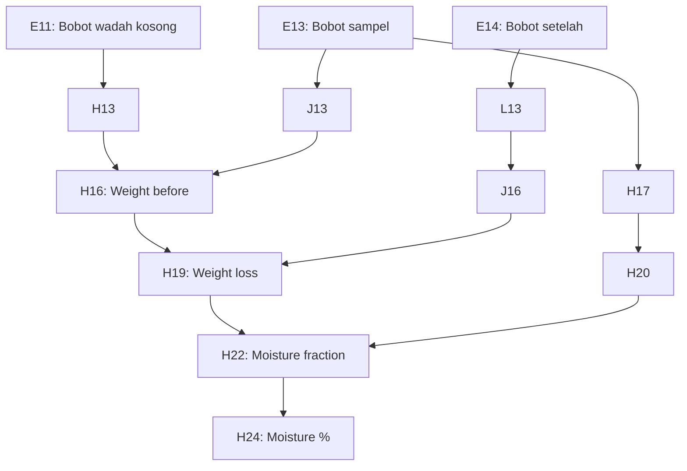

## 2. Ash Content Dependencies
### Input → Output Chain
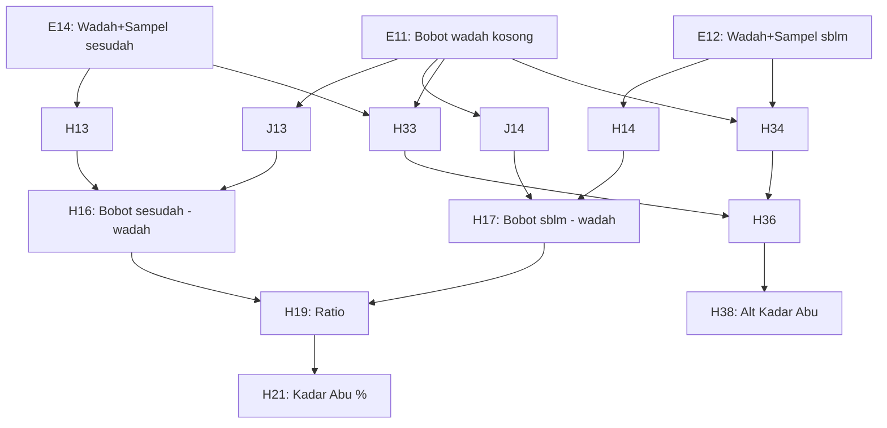

### Topological Sort Order
1. Read E11, E12, E14
2. Calculate J13, J14, H14, H13, H33, H34
3. Calculate H16, H17
4. Calculate H19, H36
5. Calculate H21, H38

## 3. Protein Content Dependencies (with standardization sub-chain)
### Input → Output Chain
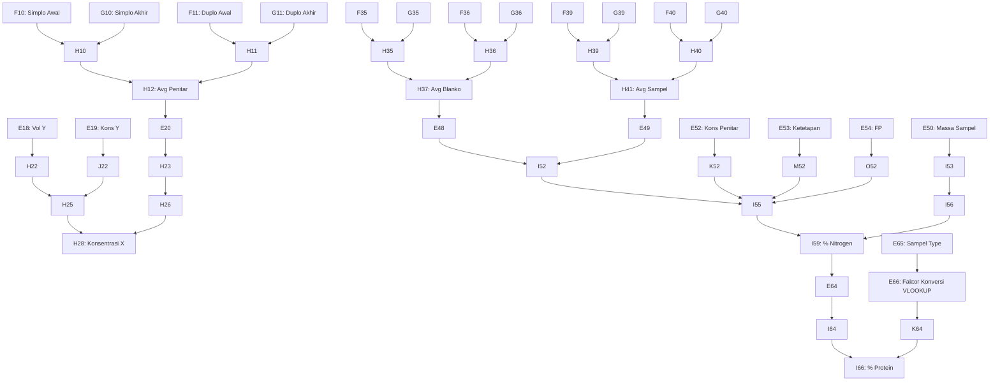

### Topological Sort Order
1. Read Standardization inputs: F10, G10, F11, G11, E18, E19
2. Calc H10, H11 -> H12
3. Calc H22, J22, H23 -> H25, H26 -> H28
4. Read Titration inputs: F35, G35, F36, G36, F39, G39, F40, G40
5. Calc H35, H36 -> H37; H39, H40 -> H41
6. Calc I52 (Blanko - Sampel)
7. Calc I55 (Product of I52, K52, M52, O52)
8. Calc I59 (% Nitrogen)
9. Lookup E66 based on E65
10. Calc I66 (% Protein)

## 4. Protein Standardless Dependencies
### Input → Output Chain
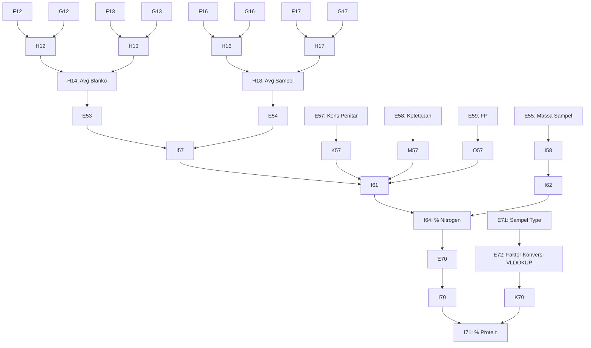

### Topological Sort Order
1. Read Titration inputs: F12, G12, F13, G13, F16, G16, F17, G17
2. Calc H12, H13 -> H14; H16, H17 -> H18
3. Calc I57 (Blanko - Sampel)
4. Calc I61 (Product of I57, K57, M57, O57)
5. Calc I64 (% Nitrogen)
6. Lookup E72 based on E71
7. Calc I71 (% Protein)

## 5. Carbohydrate Dependencies (with standardization + Luff Schoorl lookup + interpolation)
### Input → Output Chain
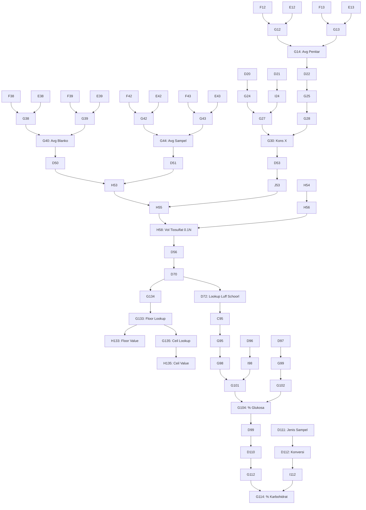

### Topological Sort Order
1. Read Standardization inputs
2. Calc G12, G13 -> G14
3. Calc G30 (Konsentrasi Penitar)
4. Read Titration inputs
5. Calc G38, G39 -> G40; G42, G43 -> G44
6. Calc H58 (Volume Tiosulfat 0.1N)
7. Lookup D72 using Luff Schoorl table (and interpolation)
8. Calc G104 (% Glukosa)
9. Lookup D112 based on D111
10. Calc G114 (% Karbohidrat)

## 6. Molar Mass Dependencies
### Input → Output Chain
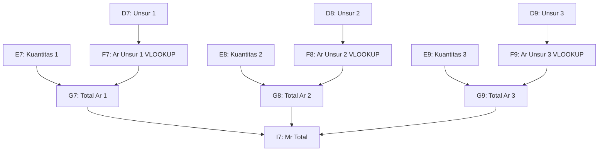

### Topological Sort Order
1. Lookup Atomic Masses for components (F7, F8, F9...)
2. Multiply by quantity (G7, G8, G9...)
3. Sum totals for Molar Mass (I7/J7)

## 7. Equivalent Weight Dependencies
### Input → Output Chain
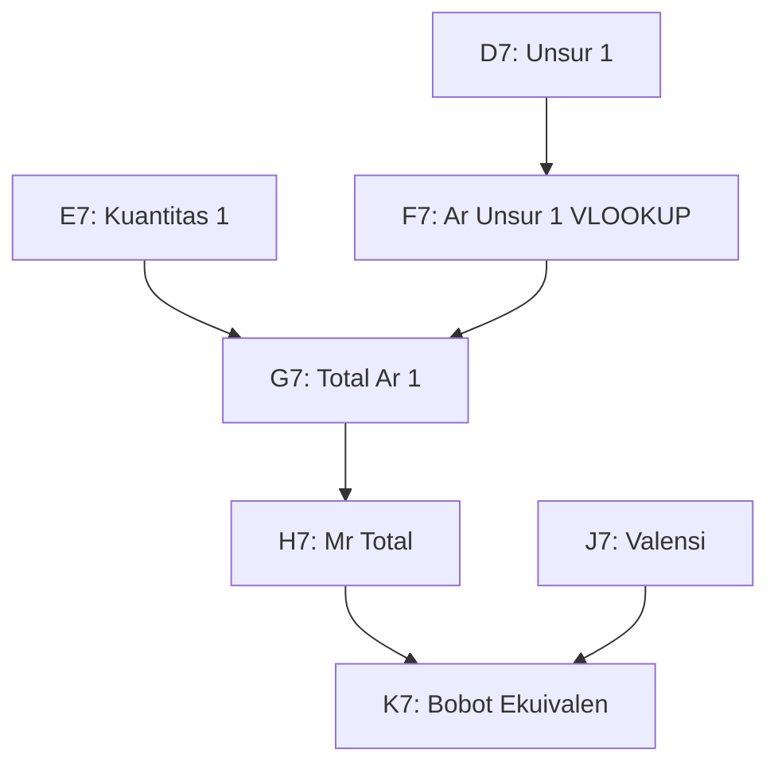

### Topological Sort Order
1. Lookup Atomic Masses for components
2. Multiply by quantity
3. Sum totals for Molar Mass
4. Divide Molar Mass by Valence to get Equivalent Weight (K7)

## 8. Standardization Dependencies
### Input → Output Chain
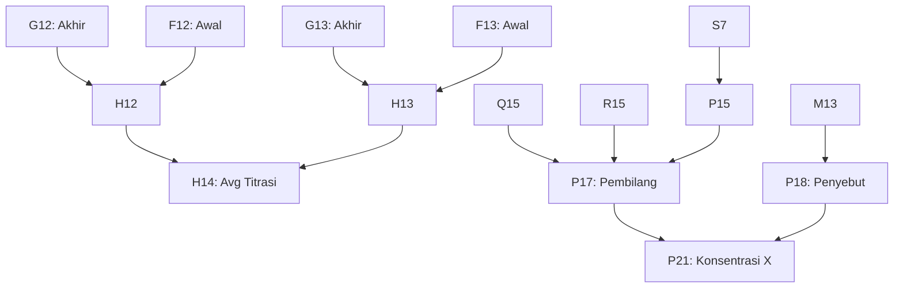

### Topological Sort Order
1. Calc Titration Differences H12, H13 -> Average H14
2. Setup parameters P15, Q15, R15 -> P17
3. Setup denominator P18
4. Calc P21 (Konsentrasi X)

## 9. Standardization & Kadar Dependencies
### Input → Output Chain
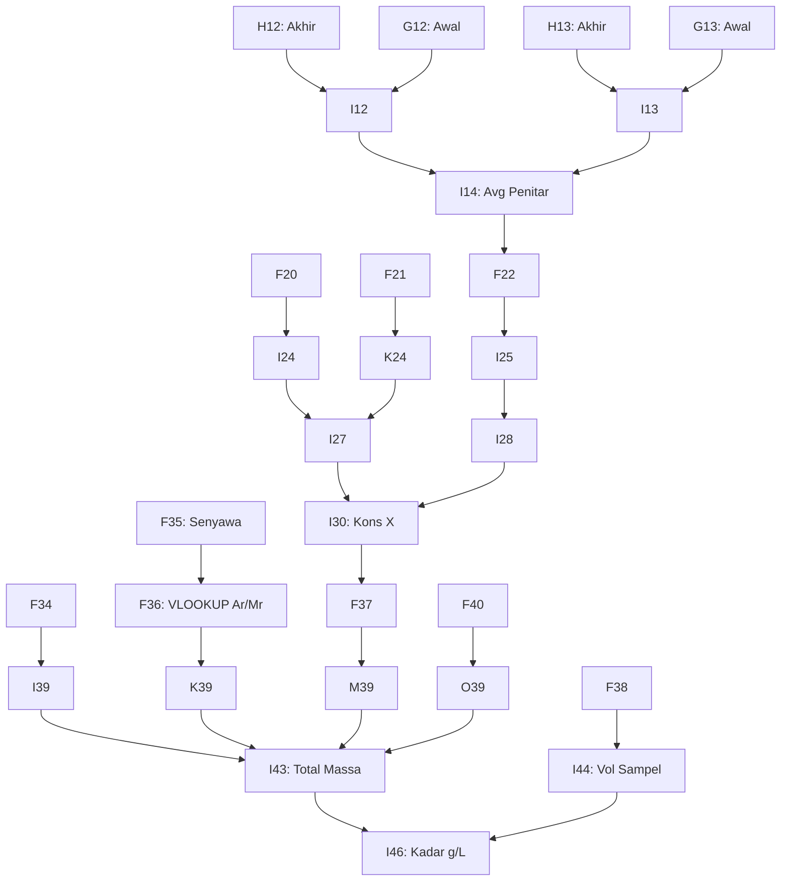

### Topological Sort Order
1. Calc Standardization Titration Differences I12, I13 -> Average I14
2. Calc Standardization Concentration I30
3. Lookup Molar Mass F36
4. Calc Product I43
5. Calc Kadar I46

## 10. Penetapan Kadar Dependencies
### Input → Output Chain
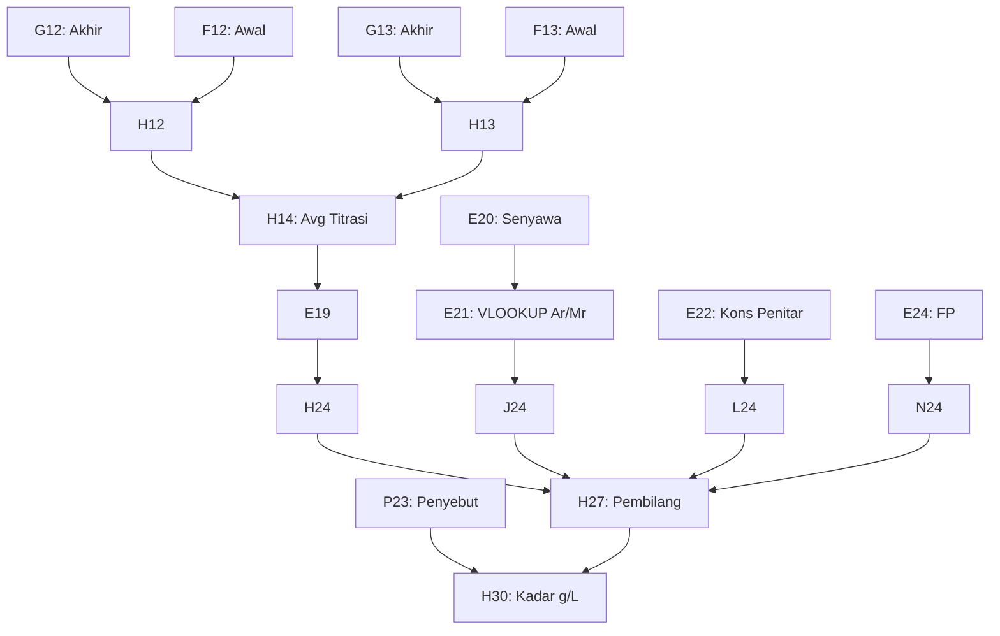

### Topological Sort Order
1. Calc Titration Differences H12, H13 -> Average H14
2. Lookup Molar Mass E21
3. Compute Product H27
4. Compute Final Kadar H30

## 11. Titration Curve Dependencies
### Input → Output Chain
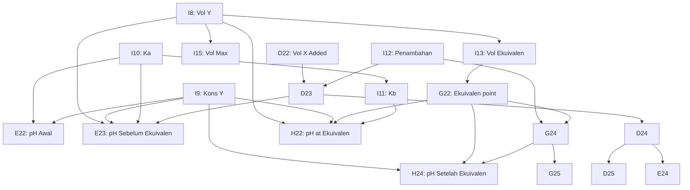

### Topological Sort Order
1. Read Ka, Vol Y, Kons Y, Penambahan
2. Calc Kb, Vol Ekuivalen, Vol Max
3. Calc Initial pH E22
4. Iterate over volume additions (D23, D24, ...) and compute pH before equivalence (E23, E24, ...)
5. Calc pH at Equivalence (H22)
6. Iterate over volume additions after equivalence (G24, G25, ...) and compute pH (H24, H25, ...)

## Cross-Sheet Dependencies
1. **Massa Molar → SPU KIMIA**
   - References `'[1]SPU-HOME'!D6:$F$124` for Atomic Mass (Ar) using VLOOKUP.
2. **Bobot Ekuivalen → SPU KIMIA**
   - References `'[1]SPU-HOME'!$C$6:$D$124` for Atomic Mass (Ar) using VLOOKUP.
3. **FORMAT STANDARDISASI&KADAR → SPU KIMIA**
   - References `'SPU KIMIA'!C7:D124` for Ar/Mr using VLOOKUP.
4. **FORMAT PENETAPAN KADAR → SPU KIMIA**
   - References `'SPU KIMIA'!C7:D124` for Ar/Mr using VLOOKUP.
5. **Format Kadar Protein → (Self)**
   - Conversion Factor VLOOKUP references table on the same sheet (`D105:E122`).
6. **karbo → Konversi Tabel Luff Schoorl / Self**
   - VLOOKUPs reference Luff Schoorl values (often integrated into same sheet `C148:F169` or `H70:K93`).

## Dependency Graph Summary
For all sheets, calculation progresses from empirical readings (weights, titrant volumes) → Differences (Weight loss, Volume used) → Averages → Sub-computations (Concentration of titrant, interpolated lookup factors) → Final formula product/quotient → Percentages or Concentrations.
