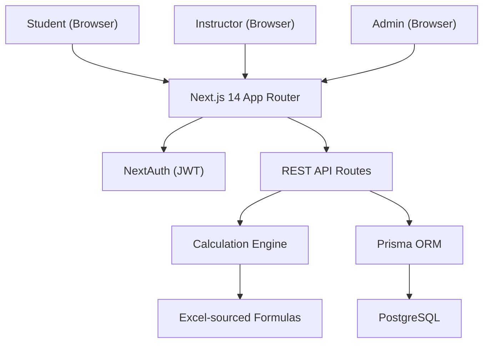
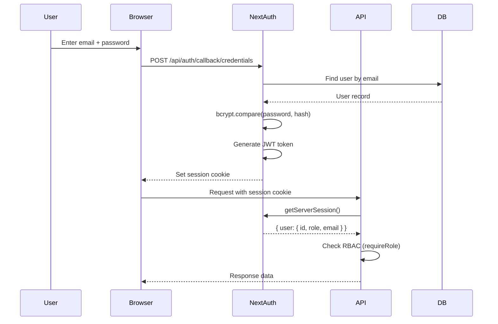
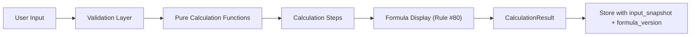
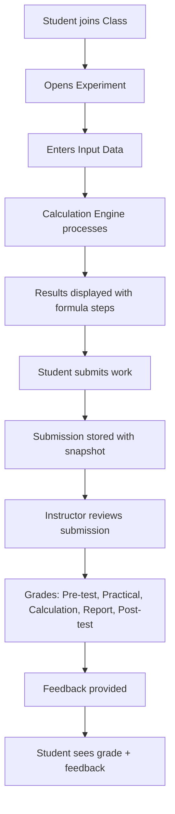
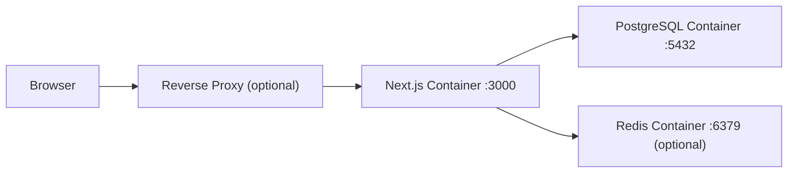

# Architecture

## System Overview

VirtualLab AKUANALIS is a production-ready web application for chemistry analysis practicum (laboratory simulation). It faithfully reproduces Excel-based analytical chemistry calculations in a structured, auditable web platform.



## Tech Stack

| Layer | Technology | Version |
|-------|-----------|---------|
| Frontend | Next.js (App Router) | 16.x |
| Language | TypeScript | 5.x |
| UI | Tailwind CSS | 4.x |
| Icons | Lucide React | 1.x |
| Charts | Recharts | 3.x |
| ORM | Prisma | 5.x |
| Database | PostgreSQL | 16.x |
| Auth | NextAuth.js | 4.x |
| Hashing | bcryptjs | 3.x |
| Validation | Zod | 4.x |
| PDF | jsPDF + jspdf-autotable | 4.x |
| Excel | xlsx | 0.18.x |
| Testing | Vitest | 5.x |
| E2E | Playwright | latest |
| Container | Docker + docker-compose | latest |

## Directory Structure

```
virtuallab/
├── prisma/
│   ├── schema.prisma          # 23 database models
│   ├── seed.ts                # Demo data seeding
│   └── migrations/            # Database migrations
├── src/
│   ├── app/
│   │   ├── api/               # 56 REST API routes
│   │   │   ├── auth/          # Authentication endpoints
│   │   │   ├── calculations/  # 10 calculation endpoints
│   │   │   ├── classes/       # Class management
│   │   │   ├── experiments/   # Experiment management
│   │   │   ├── submissions/   # Submission & grading
│   │   │   ├── formulas/      # Formula management (versioned)
│   │   │   ├── chemistry/     # Periodic table & compounds
│   │   │   ├── reports/       # PDF & Excel export
│   │   │   └── ...
│   │   ├── dashboard/         # 21 dashboard pages
│   │   ├── login/             # Login page
│   │   └── register/          # Registration page
│   ├── components/ui/         # Reusable UI components
│   └── lib/
│       ├── auth.ts            # NextAuth configuration
│       ├── prisma.ts          # Prisma client singleton
│       ├── api-response.ts    # Standardized API responses
│       ├── audit.ts           # Audit logging
│       ├── calculations/      # Calculation engine
│       │   ├── engine.ts      # Core engine with lookup tables
│       │   ├── formula-display.ts # Rule #80 formula display
│       │   ├── rounding.ts    # Rounding utilities
│       │   ├── types.ts       # TypeScript interfaces
│       │   ├── validation.ts  # Input validation
│       │   ├── proximate/     # Moisture, Ash, Protein, Carbohydrate
│       │   ├── volumetric/    # Standardization, Assay, Dilution
│       │   ├── chemistry/     # Molar Mass, Equivalent Weight
│       │   ├── luff-schoorl/  # Luff Schoorl lookup & calculations
│       │   └── titration/     # Titration curve & pH calculations
│       └── validations/       # Zod schemas
├── tests/
│   ├── calculations/          # 12 unit test files (133 tests)
│   ├── excel-validation/      # Excel regression tests
│   ├── integration/           # API integration tests
│   └── e2e/                   # Playwright E2E tests
├── docs/                      # Project documentation
├── Dockerfile                 # Production Docker image
├── docker-compose.yml         # Full stack deployment
└── vitest.config.ts           # Test configuration
```

## Authentication Flow



- **Provider**: Credentials (email + password)
- **Strategy**: JWT (stateless sessions)
- **Password**: bcrypt with 12 rounds
- **Session**: HttpOnly cookie managed by NextAuth
- **Audit**: Login/Logout events logged to AuditLog table

## RBAC Model

| Role | Access Level |
|------|-------------|
| **ADMIN** | Full access: user management, formula management, chemistry database, audit logs, all instructor features |
| **INSTRUCTOR** | Class management, experiment creation, submission review, grading, analytics, reports |
| **STUDENT** | Join classes, run experiments, input data, view calculations, submit work, view grades |

Authorization is enforced at the API level using `requireRole()` and `requireAuth()` middleware functions.

## Calculation Engine Architecture

The engine is designed to be **deterministic, pure, testable, auditable, and versioned** (Rule #79).



**Key Principles:**
- All formulas sourced from Excel workbooks (Rule #89)
- Pure functions with no side effects
- Every calculation produces traceable steps with formula IDs
- Formula display shows generic formula → substituted values → result
- Results stored with input snapshots for reproducibility (Rule #83)
- AI/LLM never used for generating scientific numbers (Rule #79)

## Data Flow



## Database Architecture

23 Prisma models organized into domains:

| Domain | Models |
|--------|--------|
| Users & Auth | User, Student, Instructor |
| Classes | Class, ClassMember |
| Labs | LabModule, Experiment |
| Sessions | ExperimentSession, ExperimentInput, CalculationResult |
| Submissions | Submission, Grade |
| Quizzes | Quiz, QuizQuestion, QuizAttempt, QuizAnswer |
| Chemistry | ChemicalElement, ChemicalCompound, CompoundElement, LuffSchoorlTable, LuffSchoorlValue, ProteinConversionFactor, ConversionFactor |
| Formulas | Formula, FormulaVersion |
| Audit | AuditLog |

## Deployment Architecture



Docker Compose provides three services:
- **web**: Next.js production build
- **postgres**: PostgreSQL 16 Alpine with health checks
- **redis**: Redis 7 Alpine for optional caching/rate limiting
